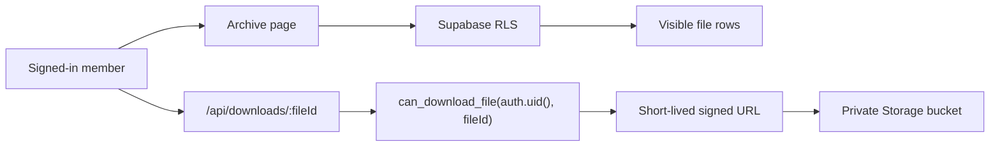

# Architecture

## Request Flow

## Design Choices

- The application route handles downloads so storage URLs are not the access
  boundary.
- The database function derives the caller from `auth.uid()` so callers cannot
  ask whether a different user can access a file.
- The `visible_archive_files` view uses `security_invoker = true` so it follows
  the querying user's RLS policies.
- Admin behavior is represented by `profiles.role = 'admin'` rather than
  user-editable auth metadata.

## Extraction Boundary

This starter is designed to be reusable. It should avoid:

- Client-specific naming
- Real client data
- Multi-tenant complexity
- Billing
- AI features
- A generic page-builder CMS

The useful template is the access-controlled archive spine.
